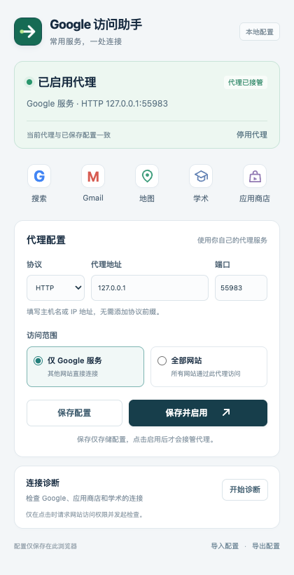

# Google Access Helper

**可直接安装的 Chrome MV3 扩展：代理配置、Google 服务入口与连接诊断。**

[](https://github.com/zcjunblog/google-access-helper2022/stargazers)
[](https://github.com/zcjunblog/google-access-helper2022/actions/workflows/extension.yml)

[下载安装包](https://github.com/zcjunblog/google-access-helper2022/releases/latest) · [安装与使用](docs/install.md) · [隐私与权限](docs/privacy.md) · [实现与测试](docs/development.md) · [更新记录](CHANGELOG.md)

一个无需构建、没有运行时依赖的浏览器助手。打开扩展即可使用 Google 搜索、Gmail、地图、学术和应用商店入口；填写已有代理信息后，可以保存配置、启停代理、切换访问范围并按需检查服务连接。

本仓库包含完整实现和安装包，核心代码在 [`extension/`](extension/) 中。

<p align="center"></p>

## 下载安装

1. 在 [Releases](https://github.com/zcjunblog/google-access-helper2022/releases/latest) 下载 `google-access-helper-1.0.0.zip` 并解压。
2. 在 Chrome 打开 `chrome://extensions/`，开启右上角的**开发者模式**。
3. 点击**加载已解压的扩展程序**，选择解压出的 `google-access-helper` 文件夹。
4. 点击浏览器工具栏中的扩展图标即可使用。

也可以下载仓库源码，直接选择其中的 [`extension/`](extension/) 文件夹加载。安装不需要 Node.js、npm 或 Python。详细步骤见 [安装指南](docs/install.md)。

## 可以直接做什么

| 功能 | 使用方式 |
| --- | --- |
| **常用服务入口** | 点击搜索、Gmail、地图、学术或应用商店，直接打开对应页面 |
| **代理配置与启停** | 填写主机和端口，选择 HTTP、HTTPS 或 SOCKS5；保存或立即启用 |
| **Google 域名规则** | 常见 Google 域名及其子域走代理，其他网站直接连接 |
| **全部网站模式** | 使用同一代理配置，保留本地地址绕过规则 |
| **实际状态显示** | 从浏览器读取生效配置，显示接管状态、配置是否一致及冲突情况 |
| **连接诊断** | 点击授权后检查 Google 搜索、Chrome 商店和 Google 学术，显示状态码、耗时、超时或连接失败 |
| **配置导入与导出** | 使用版本化 JSON 文件备份或迁移配置；导入后不会自动启用 |

代理功能使用你已有的代理服务器或本地代理软件。默认 `127.0.0.1:7890` 只是常见配置示例，请按自己的软件或服务修改；扩展不提供网络线路。安装、保存和导入配置均不会自动更改代理，只有点击“保存并启用”才会生效。

点击“停用代理”会释放本扩展的设置，由浏览器原有设置继续控制，不会强制所有连接直连。

## 权限与数据

- 必需权限只有 `proxy` 和 `storage`，用于修改浏览器代理设置和本地保存配置。
- 连接诊断使用三个明确网站的**可选访问权限**，仅在点击诊断时申请和检查。
- 没有内容脚本、网页内容采集、分析 SDK、远程执行代码或账号系统。
- 配置保存在 `chrome.storage.local`；不支持保存用户名、密码或订阅密钥。

完整说明见 [隐私与权限](docs/privacy.md)。

## 开发与验证

扩展本身是原生 JavaScript ES modules + HTML/CSS，无打包步骤。开发测试使用 Node.js 22+、Python 3.9+ 和 Playwright：

```bash
npm ci
npm test
npx playwright install chromium
npm run test:browser
npm run package
```

浏览器测试使用独立 Chromium 配置目录和本地测试代理，验证真实 MV3 加载、代理接管、PAC 设置、实际 HTTP 转发、停用、保存恢复及配置导入导出。发布包生成到 `dist/`，附带 `SHA256SUMS`。详见 [实现与测试](docs/development.md)。

## 更多资料

- [安装与使用](docs/install.md)
- [兼容性与排错](docs/migration.md)
- [其他代理配置工具](docs/alternatives.md)
- [参与贡献](CONTRIBUTING.md)

## English

An installable Manifest V3 Chrome extension with proxy configuration, Google service shortcuts, and on-demand connectivity diagnostics. Load the `extension/` folder directly or download the release ZIP. Supports HTTP, HTTPS and SOCKS5 proxy settings, Google-only or all-site scope, JSON import/export, and real browser state. Bring your own proxy service. No build or runtime dependencies are required.
